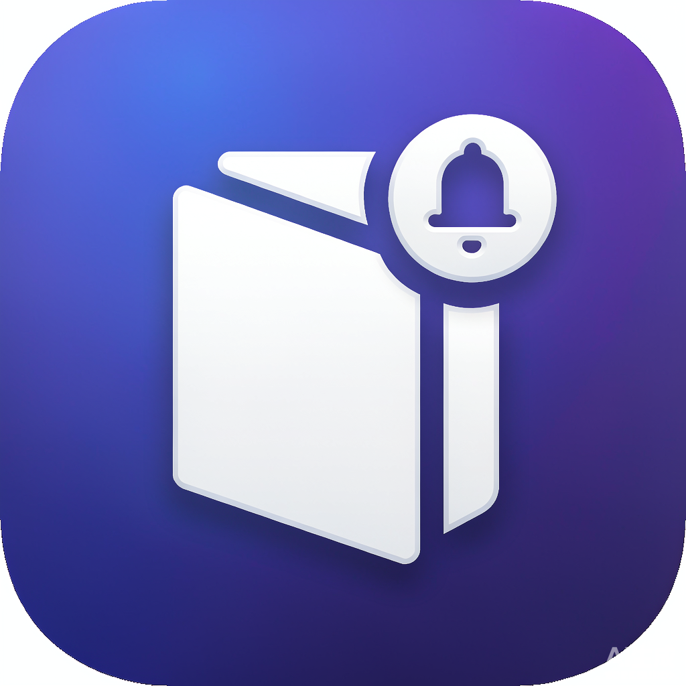

# 📦 应用下载

在这里下载 ktyhub 出品的桌面应用。

---

## Stags Tracker — GitHub 订阅追踪（macOS）

> 由 IDEA 插件 Stags 演化而来的独立 macOS 桌面应用，帮你追踪关注的 GitHub 仓库，不打断工作流。

  
   <b>Stags Tracker</b>

  

### ✨ 核心功能

- **🚀 仓库订阅**：输入 `owner/repo` 或**关键词搜索**（自动联想星标数、简介）一键订阅任意 GitHub 仓库（Release / Issue / Pull Request 全追踪）
- **🔔 更新提醒**：侧边栏未读徽标 + 应用内提示，每 15 分钟自动检测新版本
- **📦 离线缓存**：数据本地缓存，断网也能浏览已拉取的 Release
- **🌐 一键翻译**：Release Notes 翻译为中文（结果本地缓存，重复查看零开销）
- **⚙️ Token 支持**：不配置 60 次/小时，配置 GitHub Token 后提升至 5000 次/小时（仅存本机）

### 💿 下载安装

[:material-download: 下载 macOS 版 (Intel)](https://github.com/ktyhub/thinking-in-code/releases/latest/download/Stags-Tracker-macOS.zip){ .md-button .md-button--primary }
[:material-github: 查看全部版本](https://github.com/ktyhub/thinking-in-code/releases){ .md-button }

**安装步骤：**

1. 下载并解压 `Stags-Tracker-macOS.zip`
2. 将 **Stags Tracker.app** 拖入「应用程序」文件夹
3. 首次打开如提示无法验证开发者，请**右键点击应用 → 打开**
4. 点击左侧「＋ 添加订阅」，输入仓库全名（如 `apache/dubbo`）即可开始追踪

### 📋 系统要求

| 项目 | 要求 |
|------|------|
| 操作系统 | macOS 10.15 及以上 |
| 芯片 | Intel / Apple Silicon（Rosetta 2 转译） |
| 网络 | 需要访问 github.com 与 api.github.com |

### ❓ 常见问题

**Q: 应用打不开，提示"已损坏"？**
未签名应用在部分 macOS 版本上会有此提示，终端执行：
`xattr -cr /Applications/Stags\ Tracker.app` 后重新打开。

**Q: 需要付费吗？**
完全免费开源。

**Q: 与 IDEA 插件版 Stags 的数据互通吗？**
暂不互通。插件版数据存于 IDE 配置目录，桌面版存于本机浏览器配置，二者独立使用。
